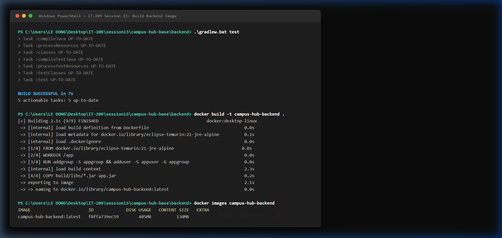
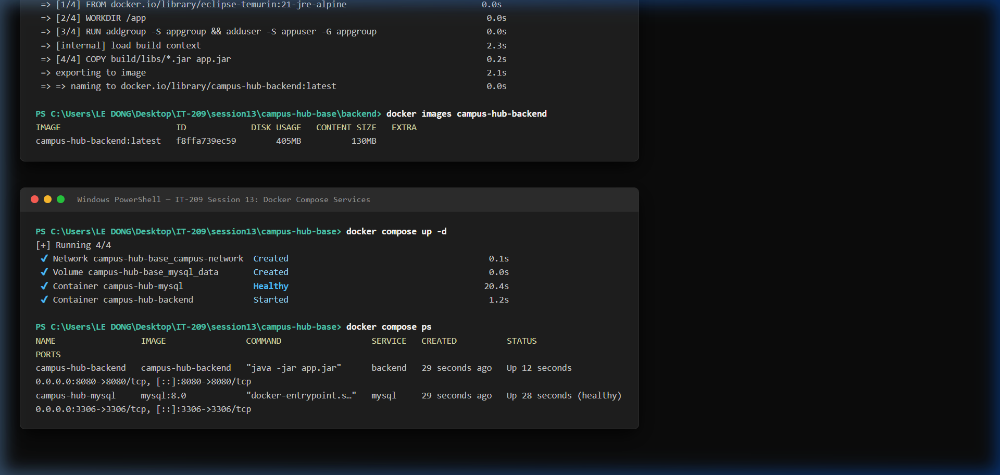
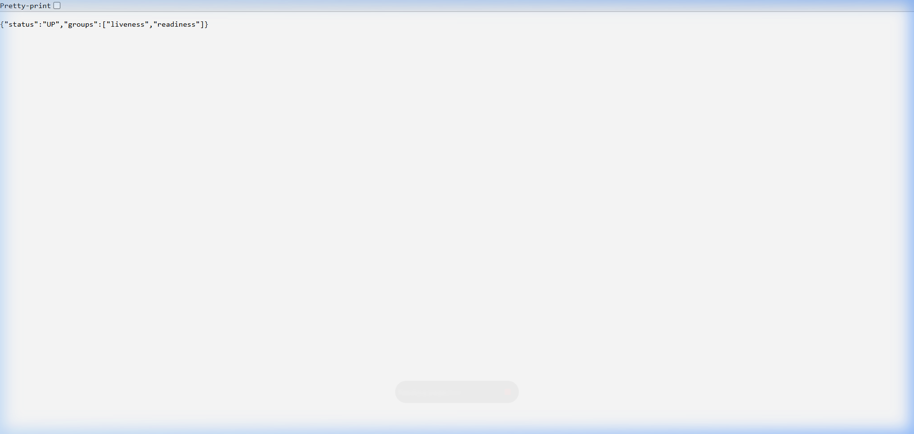

# Campus Hub - Docker & Docker Compose Triển Khai Hệ Thống

## 📌 Thông tin sinh viên
- **Họ và tên:** Lê Trung Đông
- **Mã sinh viên:** PTIT-HN-010
- **Repository:** https://github.com/ptitvn/IT-209-Devops-session13-bktr-daugio.git

---

## 🚀 Hướng dẫn chạy hệ thống

### 1. Kiểm thử backend và đóng gói Docker Image
Di chuyển vào thư mục `backend`:
```powershell
cd backend

# Chạy kiểm thử bằng Gradle
./gradlew test

# Đóng gói ứng dụng thành file JAR
./gradlew bootJar

# Build Docker Image cho backend
docker build -t campus-hub-backend .

# Kiểm tra Docker Image vừa tạo
docker images campus-hub-backend
```

### 2. Khởi chạy hệ thống bằng Docker Compose
Từ thư mục gốc của dự án (`campus-hub-base`):
```powershell
# Kiểm tra cấu hình compose
docker compose config

# Khởi chạy đồng thời Backend và MySQL ở chế độ background
docker compose up -d

# Kiểm tra trạng thái các container đang chạy
docker compose ps
```

### 3. Cổng và URL kiểm tra backend
- **Cổng công khai backend:** `8080`
- **URL kiểm tra sức khỏe hệ thống (Health Check):**
  - URL: `http://localhost:8080/actuator/health`
  - Lệnh kiểm tra:
    ```powershell
    curl http://localhost:8080/actuator/health
    ```
  - Kết quả mong đợi: HTTP 200 `{"status":"UP","groups":["liveness","readiness"]}`
- **URL API kiểm tra dữ liệu bài đăng:** `http://localhost:8080/api/posts`

---

## 📷 Minh chứng hoàn thành bài làm

### 1. Minh chứng 1: Docker Image đã build thành công
*Lệnh:* `docker images campus-hub-backend`


### 2. Minh chứng 2: Trạng thái các service sau khi chạy Compose
*Lệnh:* `docker compose ps` (Cả 2 container `campus-hub-backend` và `campus-hub-mysql` đều Up và Healthy)


### 3. Minh chứng 3: Kết quả gọi `/actuator/health` trả về HTTP 200 và UP
*Lệnh:* `curl -i http://localhost:8080/actuator/health`


---

# Giới thiệu dự án gốc Campus Hub Base

## Chức năng có sẵn

- Xem, tìm kiếm và lọc bài đăng.
- Đăng ký, đăng nhập bằng HTTP Basic.
- Tạo bài đăng theo chuyên mục.
- Bình luận và bày tỏ quan tâm.
- Chủ bài đăng có thể đánh dấu bài đã hoàn tất.
- Quản trị viên có quyền quản lý trạng thái bài đăng qua API.
- Health check tại `/actuator/health`.

Tài khoản mẫu được tạo khi ứng dụng khởi động lần đầu:

| Vai trò | Tên đăng nhập | Mật khẩu |
|---|---|---|
| Sinh viên | `student` | `student123` |
| Quản trị viên | `admin` | `admin123` |

Các tài khoản này chỉ dùng để trình diễn. Nhóm cần thay đổi hoặc loại bỏ trước khi sử dụng trong bối cảnh thực tế.

## Kiến trúc

```text
React frontend
    │ /api
    ▼
Spring Boot monolith
    │ JDBC
    ▼
MySQL
```

Backend gồm năm bảng chính: `users`, `categories`, `posts`, `comments` và `reactions`. Frontend không sử dụng thư viện giao diện hay thư viện quản lý trạng thái để sinh viên dễ đọc mã nguồn.

## Chạy khi phát triển

Tạo database MySQL tên `campus_hub`, sau đó đặt các biến môi trường nếu thông tin kết nối khác giá trị mặc định:

```powershell
$env:DB_URL = "jdbc:mysql://localhost:3306/campus_hub"
$env:DB_USERNAME = "root"
$env:DB_PASSWORD = "your-password"
```

Chạy backend:

```powershell
cd backend
./gradlew.bat bootRun
```

Mở terminal khác để chạy frontend:

```powershell
cd frontend
npm install
npm run dev
```

Frontend phát triển chạy tại `http://localhost:5173` và chuyển tiếp `/api` tới backend tại cổng `8080`.

## API chính

| Phương thức | Đường dẫn | Mục đích | Xác thực |
|---|---|---|---|
| `POST` | `/api/auth/register` | Tạo tài khoản | Không |
| `GET` | `/api/auth/me` | Lấy người dùng hiện tại | Có |
| `GET` | `/api/categories` | Danh sách chuyên mục | Không |
| `GET` | `/api/posts` | Tìm và lọc bài đăng | Không |
| `GET` | `/api/posts/{id}` | Chi tiết bài đăng | Không |
| `POST` | `/api/posts` | Tạo bài đăng | Có |
| `PUT` | `/api/posts/{id}` | Sửa bài của mình | Có |
| `PATCH` | `/api/posts/{id}/status` | Đổi trạng thái | Có |
| `DELETE` | `/api/posts/{id}` | Xóa bài của mình | Có |
| `POST` | `/api/posts/{id}/comments` | Thêm bình luận | Có |
| `POST` | `/api/posts/{id}/reaction` | Bật hoặc tắt quan tâm | Có |

Các API cần xác thực sử dụng header HTTP Basic. Trong môi trường công khai, hệ thống phải được đặt sau HTTPS.

## Kiểm tra trước khi bàn giao

```powershell
cd backend
./gradlew.bat test

cd ../frontend
npm ci
npm run lint
npm run build
```

## Phạm vi cố ý để mở

Dự án nền chưa có tải tệp, thông báo thời gian thực, email, phân trang trên giao diện, lịch sử thay đổi, dashboard và quy trình kiểm duyệt hoàn chỉnh. Nhóm có thể phát triển các hướng này, sửa sâu dự án nền hoặc thay thế toàn bộ công nghệ nếu phù hợp với ý tưởng của mình.

Dự án không cung cấp sẵn Dockerfile, Docker Compose, cấu hình web server hoặc quy trình CI/CD. Phân tích hệ thống và lựa chọn toàn bộ phương án xây dựng, đóng gói, triển khai là công việc của từng nhóm trong Mini Project.
